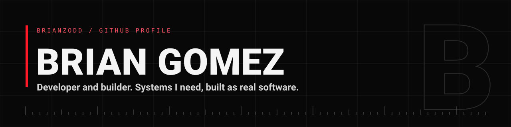

  

# ⚒️ MEET BRIAN

**`DEVELOPER`** **`BUILDER`** **`SYSTEMS THINKER`** **`AI-NATIVE`**

I'm Brian Gomez — a developer and builder who turns the systems I need in my own life into real software, then documents all of it in public. I build local-first AI tooling, mobile and web apps, and the workflow that lets one person ship like a team: an AI-native development stack (Claude Code + Codex) with its own skills, agents, and guardrails. I'm obsessed with local AI, machine-as-code, and the idea that the best way to prove you can build is to show the builds.

  
  

  
  
  
  
  

<!-- STARS stays parked until the count is non-zero (a zero reads worse than no badge).
  
-->

---

# Current Projects

> These repos are private while they're in active development. Every project name links to its own page on **[brianzodd.com](https://brianzodd.com/projects/)** — what it is, the stack, screenshots, and a dated build log.

## AI Systems

* 🧠 [**Pantheon**](https://brianzodd.com/projects/pantheon/) — A local-first **agentic OS**: project pipeline, second brain, and AI harness in one installable web app. Raw dumps in, triaged projects out; local models first (Ollama / LM Studio), cloud keys optional. FastAPI + React/TypeScript PWA with streaming local-model chat, a browsable vault, skills + an agent crew, an MCP client, automations, and a Life-OS layer.

* 🛰️ [**Nova**](https://brianzodd.com/projects/nova/) — My AI workspace: the versioned system that defines how every AI harness works for me. A 34-skill stack, delegation agent tiers, guardrail hooks, session-budget gates, and a live bridge that lets Claude Code and Codex share one source of truth — single-sourced, drift-checked, evolving daily.

* 📚 [**Alfred**](https://brianzodd.com/projects/alfred/) — A lifelong second brain in plain markdown: the external memory of what I know, believe, own, and plan — filed, interviewed, and challenged by an AI agent, with the reasoning behind every change kept in git. Obsidian-browsable; the files are the product.

## Apps & Platforms

* 🏛️ [**Crucible**](https://usecrucible.app) — A habits-and-accountability app: *"get your life together" with the structure of a video game and the aesthetic of Greco-Roman discipline.* A 91-day program of daily trials (sleep, training, reading, meditation…), streaks, XP, levels, achievements, and a champion you forge over time. React Native (Expo) + Supabase, Android + iOS. **In development.**

* 🥗 [**Avalon**](https://brianzodd.com/projects/avalon/) — A health-first nutrition tracker: micronutrient-deep tracking, an ingredient-quality lens, and AI-native logging (voice, barcode, meal templates). Mobile-first PWA with a native future. TypeScript + Supabase.

* 🚀 [**Venture**](https://brianzodd.com/projects/venture/) — A business launchpad + AI knowledge vault: research-grounded venture templates, a stage-then-eject pipeline that births new projects, and a living wiki of tools and AI-industry knowledge (a ~1,480-entry resource atlas).

## Tools & Open Source

* ⚔️ [**Gladius**](https://brianzodd.com/projects/gladius/) — A keyboard-driven wallpaper picker for Windows: a hotkey drops a translucent strip of your wallpapers over the desktop, vim keys scroll it, Space sets one, and it's gone. One Python file, PySide6. **Open source (MIT)** — [repo](https://github.com/BrianZodd/Gladius).

## Content & Brand

* 🎬 [**Envoy**](https://brianzodd.com/projects/envoy/) — The content-operations hub behind my personal brand: media library, ingest / thumbnail / research pipelines, and per-platform strategy. DaVinci Resolve is the edit bay; Envoy is everything around it.

## Machine as Code

* 🖥️ [**Anvil / Hammer**](https://brianzodd.com/projects/machine-as-code/) — Both of my Windows machines as repos: a tiling-WM desktop (komorebi + YASB + Windhawk), shell mods, power modes, app manifests, and a map-driven backup/restore lane. New machine → clone → restore.

## Skills & Technologies

                 ![OpenAI](https://img.shields.io/badge/-Codex-412991?style=flat-square&logo=data%3Aimage%2Fsvg%2Bxml%3Bbase64%2CPHN2ZyB4bWxucz0iaHR0cDovL3d3dy53My5vcmcvMjAwMC9zdmciIHZpZXdCb3g9Ii0xNSAtMTUgMTIwIDEyMCIgZmlsbD0iI2ZmZiI%2BPHBhdGggZD0iTTM4LjM1NSAzNi41MnYtOS40MTVjMC0uNzkzLjI5Ny0xLjM4OC45OS0xLjc4NGwxOC45My0xMC45MDJjMi41NzgtMS40ODYgNS42NS0yLjE4IDguODItMi4xOCAxMS44OTQgMCAxOS40MjYgOS4yMTggMTkuNDI2IDE5LjAyOSAwIC42OTQgMCAxLjQ4Ni0uMSAyLjI4TDY2Ljc5OSAyMi4wNWMtMS4xODktLjY5NC0yLjM3OS0uNjk0LTMuNTY4IDBMMzguMzU1IDM2LjUyWm00NC4yMDIgMzYuNjdWNTAuNjk0YzAtMS4zODgtLjU5Ni0yLjM4LTEuNzg1LTMuMDczTDU1Ljg5NyAzMy4xNWw4LjEyNi00LjY1OGMuNjk0LS4zOTYgMS4yODktLjM5NiAxLjk4MiAwbDE4LjkzIDEwLjkwMmM1LjQ1MiAzLjE3MiA5LjExOCA5LjkxIDkuMTE4IDE2LjQ1MiAwIDcuNTMxLTQuNDYgMTQuNDctMTEuNDk2IDE3LjM0NFptLTUwLjA1LTE5LjgyLTguMTI3LTQuNzU3Yy0uNjkzLS4zOTYtLjk5LS45OS0uOTktMS43ODRWMjUuMDI1YzAtMTAuNjA1IDguMTI2LTE4LjYzMyAxOS4xMjctMTguNjMzIDQuMTYzIDAgOC4wMjggMS4zODggMTEuMyAzLjg2NWwtMTkuNTI1IDExLjNjLTEuMTg5LjY5My0xLjc4NCAxLjY4NC0xLjc4NCAzLjA3MnYyOC43NFpNNTAgNjMuNDc4bC0xMS42NDUtNi41NDFWNDMuMDYyTDUwIDM2LjUyMmwxMS42NDUgNi41NHYxMy44NzVMNTAgNjMuNDc3Wm03LjQ4MyAzMC4xMjljLTQuMTYzIDAtOC4wMjgtMS4zODgtMTEuMy0zLjg2NWwxOS41MjUtMTEuM2MxLjE4OS0uNjkzIDEuNzg0LTEuNjg0IDEuNzg0LTMuMDcxVjQ2LjYyOWw4LjIyNiA0Ljc1N2MuNjk0LjM5Ni45OTEuOTkxLjk5MSAxLjc4NHYyMS44MDNjMCAxMC42MDUtOC4yMjYgMTguNjMzLTE5LjIyNiAxOC42MzN2LjAwMVptLTIzLjQ5LTIyLjEwMS0xOC45My0xMC45MDJjLTUuNDUtMy4xNzItOS4xMTctOS45MS05LjExNy0xNi40NTEgMC03LjYzMiA0LjU1OS0xNC40NyAxMS41OTUtMTcuMzQ0djIyLjU5NmMwIDEuMzg4LjU5NSAyLjM3OSAxLjc4NCAzLjA3MmwyNC43NzcgMTQuMzctOC4xMjYgNC42NTljLS42OTQuMzk2LTEuMjg5LjM5Ni0xLjk4MiAwWk0zMi45MDUgODcuNzZjLTExLjIgMC0xOS40MjUtOC40MjUtMTkuNDI1LTE4LjgzIDAtLjc5NC4xLTEuNTg3LjE5OC0yLjM4TDMzLjIgNzcuODVjMS4xODkuNjkzIDIuMzc5LjY5MyAzLjU2OCAwbDI0Ljg3Ni0xNC4zN3Y5LjQxNWMwIC43OTMtLjI5OCAxLjM4OC0uOTkyIDEuNzg0TDQxLjcyNCA4NS41OGMtMi41NzYgMS40ODYtNS42NDkgMi4xOC04LjgyIDIuMThoLjAwMVptMjQuNTc5IDExLjc5M2MxMS45OTIgMCAyMi4wMDEtOC41MjMgMjQuMjgxLTE5LjgyMkM5Mi44NjQgNzYuODU3IDEwMCA2Ni40NTEgMTAwIDU1Ljg0NmMwLTYuOTM3LTIuOTczLTEzLjY3Ni04LjMyNS0xOC41MzMuNDk2LTIuMDgxLjc5My00LjE2My43OTMtNi4yNDMgMC0xNC4xNzItMTEuNDk2LTI0Ljc3Ny0yNC43NzctMjQuNzc3LTIuNjc2IDAtNS4yNTMuMzk2LTcuODMgMS4yODhDNTUuNDAxIDMuMjIxIDQ5LjI1Ny40NDUgNDIuNTE3LjQ0NWMtMTEuOTkyIDAtMjIuMDAxIDguNTIzLTI0LjI4MSAxOS44MjJDNy4xMzYgMjMuMTQgMCAzMy41NDcgMCA0NC4xNTJjMCA2LjkzOCAyLjk3MyAxMy42NzYgOC4zMjUgMTguNTMzLS40OTYgMi4wODEtLjc5MyA0LjE2My0uNzkzIDYuMjQzIDAgMTQuMTcyIDExLjQ5NyAyNC43NzggMjQuNzc3IDI0Ljc3OCAyLjY3NiAwIDUuMjUzLS4zOTcgNy44My0xLjI4OSA0LjQ1OSA0LjM2IDEwLjYwNCA3LjEzNiAxNy4zNDQgNy4xMzZaIi8%2BPC9zdmc%2B&logoColor=white)  
